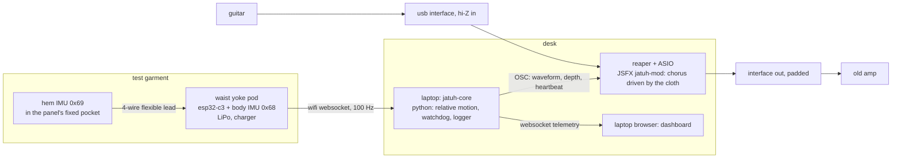
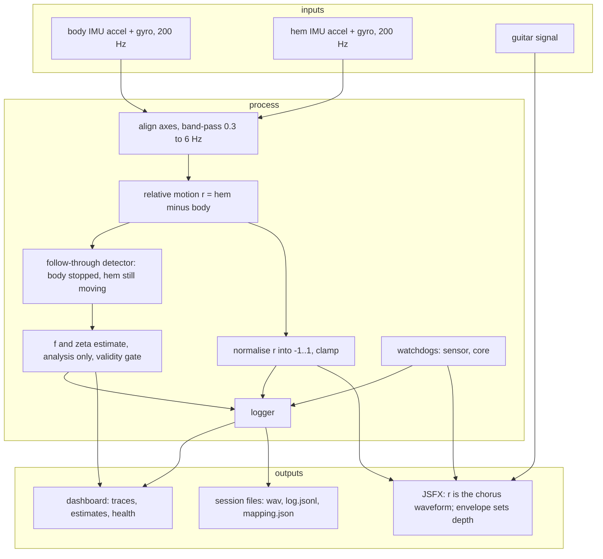
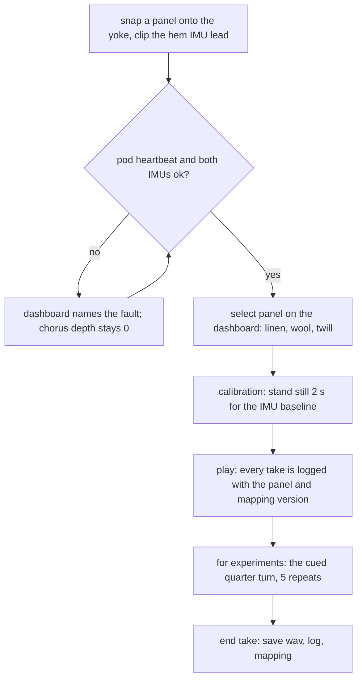
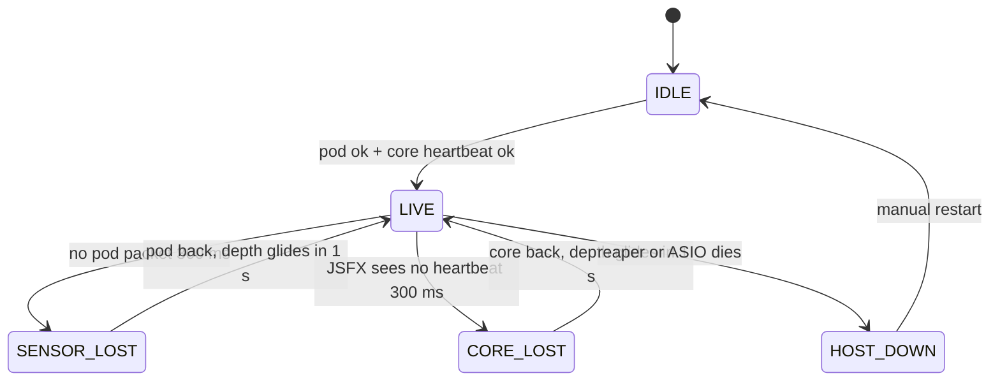

# jatuh: product requirements document

> status: **v1.0, revised after review** (see `05-review-disposition.md`). 2026-10-22. owner: naquuuu.
> this is a **working tool**, not a portfolio page. related: `01-timeline.md`, `03-blueprint.md`, `04-dashboard.md`.
> rule: nothing here claims a result that has not been measured. targets are targets, and every hypothesis can fail.

## 1. summary

**the garment becomes part of the instrument.**

a body-worn motion sensor goes quiet the moment you stop moving. a hem doesn't: it keeps swinging, then settles at a rate set by the cloth. jatuh turns that follow-through into sound. a small pod measures the hem's motion **relative to the body**, and that signal becomes the modulation waveform of the guitar's chorus. **the cloth is the LFO.** linen swings long and loose, so the shimmer rings on after you stop. twill settles fast, so the shimmer stops short.

the name: in jakarta a fabric that drapes well is *bahannya jatuh*. *jatuh* also means "to fall".

## 2. background

### 2.1 why i am doing this

- my day job is designing systems around failure. once a design leaves the screen it becomes matter: it has tolerances and no rollback.
- i sew, i play guitar (city pop, shibuya-kei), and i dress for a hot city in unlined linen, tropical wool and cotton twill. i know by hand that these fabrics move differently. i have never measured it, and i have never been able to *play* it.
- IDE is where i want to learn to turn that kind of tacit knowledge into tested physical things. jatuh is the first time i have done it end to end.

### 2.2 what i am trying to achieve

| id | goal | evidence |
| :--- | :--- | :--- |
| G1 | show the hem has a **repeatable follow-through** that differs by fabric | 5 repeats x 3 fabrics; between-fabric differences larger than within-fabric spread |
| G2 | show the difference is **audible** | the same recorded guitar phrase reamped with the same gesture and an unchanged mapping, A/B across the three panels |
| G3 | show the garment expresses something a **pedal or body sensor cannot** | the 3-condition comparison (fixed LFO, body sensor, garment) in the recordings and the play-test, trade-offs included |
| G4 | keep it **playable** | latency targets in 5.2; no stuck or ugly sound on sensor or core loss |
| G5 | show that **making and testing changed the design** | panel v1 → v2 from data; one play-test note acted on, before submission |

### 2.3 non-goals (phase A)

- no chest phone, no headstock phone, no NFC, no live canvas, no strap touch. all are phase B options (section 12).
- no machine learning. one designed mapping, tuned by ear, versioned.
- no claim that cloth changes the amp's acoustics. the garment is a sensor, and the claim is about its motion.
- no claim of "measuring drape" in the textile-science sense. we measure **this garment's worn follow-through**. swatch tests only characterise the materials.

### 2.4 constraints

- **time:** phase A is 22 oct to 4 dec 2026, next to a full-time job. IELTS moved to january 2027 (`01-timeline.md` section 2).
- **budget:** about Rp 0.9 to 1.1 juta for phase A (section 9).
- **owned:** windows laptop, electric guitar, old amp, iphone 17 pro (camera, slow motion). other owned phones are not used in phase A.
- **garments:** owned clothes are never cut. the test garment is sewn new from bought fabric.
- **safety:** protected LiPo only, never charged while worn; laptop on battery during takes (ground loops).
- **isolation:** no employer names, data or architectures in any jatuh material.

## 3. users

| user | needs |
| :--- | :--- |
| performer (you) | put it on in under 5 minutes; play without looking at a screen; never a stuck or ugly sound |
| play-tester | one sentence of instruction; can compare conditions and say which felt like playing |
| reviewer (RCA) | sees the question, the trials, the evidence and what changed, in the first seconds of video and on 3 pages |

## 4. system

### 4.1 architecture (phase A)



the laptop runs a local hotspot. no internet during a take.

### 4.2 input, process, output



### 4.3 session flow



### 4.4 failure classes (narrowed promise)

| class | example | detection | behaviour | automatic? |
| :--- | :--- | :--- | :--- | :--- |
| **sensor loss** | pod off, wi-fi drop, hem lead unplugged, I2C error | core: no packet for 300 ms, or the hem IMU flags an error | core glides depth to 0 over 1 s; the guitar keeps its clean sound | yes |
| **core loss** | python crashes, laptop lid closed on the core | **inside reaper:** JSFX watches a heartbeat counter sent every 50 ms; unchanged for 300 ms | JSFX fades its own depth to 0 over 1 s. clean guitar continues | yes, inside the audio host |
| **audio host loss** | reaper or the ASIO driver crashes | silence | **audio stops. no automatic protection.** recovery: restart reaper from the saved template (target under 30 s); core reconnects by itself. if the interface has hardware direct monitoring, turning it to full dry gives a clean signal by hand | manual |



the guitar's dry path is never modulated by a stale value: in every automatic case the fallback is "depth 0", not "hold the last value".

## 5. requirements

### 5.1 functional (phase A)

| id | requirement | priority |
| :--- | :--- | :--- |
| FR-1 | the pod reads body and hem IMUs on one I2C bus at 200 Hz and streams to core at 100 Hz with a shared timestamp | must |
| FR-2 | core computes relative motion r, normalises and clamps it, and sends it to the JSFX by OSC | must |
| FR-3 | the JSFX uses r as the chorus modulation waveform and r's envelope as depth, both clamped | must |
| FR-4 | three conditions are switchable without changing anything else: **fixed LFO**, **body IMU as LFO**, **garment r as LFO** | must |
| FR-5 | the sensor and core watchdogs behave as in 4.4 | must |
| FR-6 | every take logs panel, condition, mapping version, raw IMU data and parameter values | must |
| FR-7 | the follow-through detector marks body-stop and hem-settle times; f and zeta are estimated and validity-gated (6.1) | must |
| FR-8 | a replay tool feeds a logged IMU recording back through the same mapping (for reamp A/B with identical motion) | should |
| FR-9 | the dashboard shows health, traces, estimates, parameters and the event log | should |
| FR-10 | the pod reports battery voltage | should |

### 5.2 non-functional

| id | requirement | target | how measured |
| :--- | :--- | :--- | :--- |
| NFR-1 | audio round trip, guitar in to amp out | ≤ 12 ms (hard limit 15) | interface loopback click test |
| NFR-2 | control latency, hem motion to JSFX parameter | ≤ 40 ms p95 | timestamps in the log |
| NFR-3 | sensor stream | 100 Hz ± 5, loss < 1% | packet counter |
| NFR-4 | watchdog timeout / glide | 300 ms / 1.0 s ± 0.2 | fault injection |
| NFR-5 | mass added at the hem | ≤ 5 g (hem IMU + lead) | 0.01 g scale |
| NFR-6 | yoke pod mass | ≤ 35 g | scale |
| NFR-7 | battery | ≥ 2 h | timed run |
| NFR-8 | setup from cold | ≤ 5 min | stopwatch, 3 runs |
| NFR-9 | no zipper noise or audible stepping | none heard by you or the play-tester | listening test |

## 6. the measurement and the mapping

### 6.1 follow-through and its estimates

1. **gesture:** a quarter turn from a floor mark to a second mark, cued by a metronome at 60 bpm (turn on beat 1, stop on beat 2). the same person, the same shoes, the same panel pocket position.
2. **body stop:** body IMU gyro z below 15°/s for 200 ms.
3. **relative motion after the stop:** r(t) = hem horizontal acceleration minus body horizontal acceleration, band-passed 0.3 to 6 Hz.
4. **follow-through time T_ft:** from body stop until the envelope of r falls below 10% of its post-stop peak. this is the primary measure. it does not assume any model.
5. **estimates (secondary):** f from the mean peak interval; zeta from the log decrement over n peaks (delta = (1/n) ln(x0 / xn), zeta = delta / sqrt(4 pi^2 + delta^2)).
6. **validity gate:** an estimate is valid only if there are ≥ 3 peaks after the stop, an exponential envelope fits with R² ≥ 0.8, f is within 0.5 to 5 Hz and zeta within 0.01 to 0.7. otherwise it is **shown as invalid and logged**. it is never used to drive sound.
7. **independent check (once per fabric):** film the hem at 240 fps on the iphone 17 pro with a paper marker on the panel; count swing periods by frame to confirm the IMU's f.

### 6.2 the mapping (v1, one mapping)

| element | value | why |
| :--- | :--- | :--- |
| chorus modulation waveform | r, normalised to -1..1, one-pole smoothed at 15 Hz in the JSFX | the cloth's swing *is* the shimmer: its rate is the fabric's swing rate, its fade is the fabric's settling |
| chorus depth | envelope of r, scaled to 0 to 4 ms delay sweep, **hard clamp at 4 ms** | no movement, no shimmer; can never run away |
| chorus mix | fixed 40% | so only motion changes the sound |
| delay feedback | fixed at 25%, never sensor-driven in v1 | removes the "invalid estimate drives feedback" risk |
| tone | one fixed preset, clean, city pop register | one preset for all three fabrics, so the fabric is the only variable |

**G0 pivot (if week 1 shows no repeatable follow-through):** the same mapping, but on the envelope of r alone (how much the cloth moves against the body), with no claim about settling. the thesis becomes "the garment's movement against the body plays the instrument", which is weaker but still testable.

### 6.3 the comparison (answers "why not a pedal or a body sensor?")

| condition | modulation source | what it can't do |
| :--- | :--- | :--- |
| A. fixed LFO | a 0.8 Hz sine, fixed depth | doesn't respond to you at all |
| B. body sensor | body IMU horizontal acceleration, same processing | stops dead when you stop |
| C. garment | r, the hem relative to the body | (the claim) keeps going after you stop, at a rate set by the cloth; differs by panel |

recorded as: the same DI phrase, the same cued gesture, all three conditions, then condition C on all three panels. trade-offs are recorded too (comfort, repeatability, control, whether you can still play naturally), in the play-test (10.3).

### 6.4 the test phrase

an **original** 8-bar phrase in a city pop register, about 80 bpm: maj7 and 9 voicings, a ii-V movement, a held chord at bar 4 and bar 8 where the follow-through is audible. recorded once as a dry DI track and reused for every reamp, so the playing never changes between conditions. original, so the video and portfolio carry no cover-licensing questions.

### 6.5 material characterisation (supporting only)

on swatches cut from the same fabric used for the panels:

- **GSM:** a 10 x 10 cm swatch on a 0.01 g scale, x 100.
- **bending length c:** cantilever method in the style of ASTM D1388: a 2.5 x 20 cm strip slid off an edge until it touches a 41.5° slope; c = overhang / 2; flexural rigidity G = GSM x c³ (warp and weft).
- reported next to the follow-through results as context. not presented as proof of the worn behaviour.

## 7. data contracts

envelope for every websocket message:

```json
{ "v": 1, "role": "pod", "seq": 4182, "ts": 1730533212.481, "type": "imu",
  "data": { "body": { "ax": 0.12, "ay": -9.71, "az": 0.40, "gz": 3.1 },
            "hem":  { "ax": 0.85, "ay": -9.60, "az": 0.22, "gz": 1.4 } } }
```

| type | from → to | data |
| :--- | :--- | :--- |
| `imu` | pod → core | body and hem accel (m/s²) and gyro (°/s), 100 Hz |
| `hb` | pod → core | `{ "batt": 3.91, "rssi": -58, "hem_ok": true }` |
| OSC `/jatuh/wave` | core → reaper | r, -1..1, 100 Hz |
| OSC `/jatuh/depth` | core → reaper | 0..1 |
| OSC `/jatuh/hb` | core → reaper | counter, every 50 ms |
| OSC `/jatuh/cond` | core → reaper | 0 = fixed LFO, 1 = body, 2 = garment |
| `event` | core → dashboard, log | `{ "kind": "SENSOR_LOST", "detail": "no pod packet 312 ms" }` |
| `estimate` | core → dashboard, log | `{ "T_ft": 2.4, "f": 1.82, "zeta": 0.11, "valid": true, "peaks": 7, "r2": 0.91 }` |

session folder: `sessions/2026-11-20T21-14_linen_C/` with `take.wav`, `log.jsonl`, `mapping.json`.

## 8. stack

| part | choice | why |
| :--- | :--- | :--- |
| pod firmware | arduino-esp32 on ESP32-C3: two MPU6050s on one I2C bus (0x68, 0x69), websocket client | cheap, well documented, one clock for both IMUs |
| core | python 3: asyncio, websockets, python-osc, numpy, scipy.signal | you read python best; numpy does the filtering and fits |
| audio | reaper + ASIO; JSFX `jatuh-mod` (chorus + watchdog in the audio host) | low latency; the core-loss fallback lives where the audio is |
| dashboard | one html page served by core, canvas charts, no framework | offline, screen-recordable |

## 9. budget, phase A (estimates)

| item | qty | approx. Rp |
| :--- | :--- | :--- |
| ESP32-C3 SuperMini | 1 + 1 spare | 70k |
| MPU6050 (GY-521) | 2 + 1 spare | 60k |
| LiPo 3.7 V ~400 mAh, protected | 1 + 1 spare | 60k |
| TP4056 USB-C charger, protected | 2 | 20k |
| silicone wire 28 AWG (4 colours), JST-SH or dupont 4-pin, heat shrink, slide switch | set | 50k |
| USB audio interface, hi-Z in, ASIO driver, **hardware direct monitoring** | 1 | 250k to 400k |
| fabric 0.75 m each: linen, tropical wool, cotton twill (panels v1, v2, swatches) | 3 | 180k to 300k |
| yoke: cotton twill 0.3 m, interfacing, 20 sew-on snaps, 25 mm webbing, buckle | set | 80k |
| thread, needles, pattern paper, marking chalk | set | 40k |
| 0.01 g pocket scale, protractor, steel ruler | set | 50k |
| **phase A total** | | **about Rp 0.86 to 1.13 juta** |
| contingency 15% | | about 150k |
| phase B (overshirt fabric, strap node, touch patch) | | 250k to 450k |

not included: RCA application fee, RCA deposit, IELTS fee. owner to confirm.

## 10. testing

### 10.1 bench

| test | method | pass |
| :--- | :--- | :--- |
| estimator | synthetic damped sines with known f and zeta, plus noise | f within 3%, zeta within 10%; invalid inputs flagged |
| IMU sync | tap both IMUs together | peaks within 10 ms |
| audio latency | loopback click through the interface | ≤ 12 ms |
| control latency | 5 min log, motion ts vs OSC send ts | p95 ≤ 40 ms |
| battery | full to brownout | ≥ 2 h |

### 10.2 fault injection (each recorded on video)

| fault | expected | pass |
| :--- | :--- | :--- |
| pod switched off mid-take | SENSOR_LOST, depth to 0 in 1 s | no click, no stuck shimmer, logged |
| hem lead unplugged | `hem_ok` false → SENSOR_LOST | same |
| hotspot off | SENSOR_LOST, reconnect when back | reconnect ≤ 10 s |
| core process killed | JSFX CORE_LOST, depth to 0 in 1 s | clean guitar continues |
| reaper killed | HOST_DOWN, silence | restart from template ≤ 30 s, measured |
| guitar cable pulled | input gate closes | no hum burst |

### 10.3 experiment (G1 to G3)

| step | detail |
| :--- | :--- |
| repeats | 5 cued quarter turns per panel (3 panels), DI phrase reamped, condition C |
| comparison | the same gesture in conditions A, B and C, on the linen panel |
| analysis | per panel: T_ft mean ± SD, valid f and zeta; plot every point, not just means. **separation** if every pair of panel means differs by more than 2 x the larger of their SDs |
| audio | A/B clips: 3 panels (C) and 3 conditions (linen); loudness-matched |
| honest outcomes | if the panels don't separate, report it, and test the v2 panel change (6.1 G0 pivot or a weighted hem) |

### 10.4 play-test (1 in phase A, 2 more in phase B)

- one person, 20 minutes, instruction: "turn, stop, and listen."
- conditions A, B and C in a shuffled order, not named to the player.
- rate each 1 to 5 on: **expressive, controllable, comfortable, repeatable, could play naturally.** plus: "what could you do with one of them that you couldn't with the others?"
- pass: notes recorded; at least one change made because of them (logged in the design log).

### 10.5 v1 acceptance (gate G2, before submitting)

FR-1 to FR-7 met; NFR-1, 2, 4 and 9 passing; the fault matrix recorded once; experiment and comparison recorded; one play-test done; panel v2 made and measured.

## 11. risks

| risk | likelihood | impact | mitigation |
| :--- | :--- | :--- | :--- |
| no repeatable follow-through (G0 fails) | medium | high | week 1 go/no-go; pivot mapping in 6.2 |
| panels don't separate | medium | high | weighted hem tape in v2; longer panel drop; report honestly |
| the hem IMU lead changes the swing | medium | medium | lead under 5 g, routed along the panel seam; compare with the 240 fps video check |
| chorus from r sounds seasick | medium | medium | smoothing, depth clamp, tuning by ear before the experiment |
| ASIO latency | medium | high | interface with a known ASIO driver; 64 to 128 sample buffer |
| IELTS not ready for LPDP tahap 1 | medium | medium | test in mid january; tahap 2 + deferral fallback (`01-timeline.md` F1, F5) |
| scope creep back to six devices | high | high | phase B list is closed until G2 is passed |

## 12. phase B options (only after G2)

1. v3: the panel learnings built into an unlined overshirt you sew (the real garment).
2. strap touch patch: sashiko pads on a classic ESP32 (the C3 has no capacitive touch).
3. headstock tilt, NFC garment ID, chest heart.
4. the canvas, only after you hand-draw the mark vocabulary per fabric.
5. walking mode, skin microclimate. parked.

## 13. portfolio page plan (4 pages, the closing work of the pack, per ADR-054 via a blog page)

jatuh is the **final form** of the pack (owner, 2026-10-22): the works before it stayed on paper or on screens, and this is where the arc becomes matter.

1. **the question and the garment:** *bahannya jatuh*; why a body sensor isn't enough; the yoke and panels photographed.
2. **the making:** pattern, panel v1 → v2 and why, one readable system drawing, the pod in the pocket.
3. **the experiment:** gesture protocol, within vs between chart, the 240 fps check, the material table, a QR code linking to the A/B audio.
4. **what changed and what's next:** the play-test note that changed the design; the fault test; what you would build at IDE.

working tools (this PRD, the full drawings, the dashboard) stay internal. only details that explain a decision go on the pages.
